# Design captures

These are screenshots of the Figma designs for the resource directory, taken on 2026-11-07. The
Figma file is [WFG 2026 - MomsBloom](https://www.figma.com/design/XNxEurTwFpvw3kvVLPlea4/WFG-2026---MomsBloom),
page "Resources Page Designs". The Figma file is the source of truth: if a screenshot here and Figma
disagree, Figma wins. Each section links to its frame, so you can open it and measure spacing,
colors, and text in Figma. (Most of us have view access only, so Figma will not let us export.)

The data in the designs is made up ("Maria Sample", `example.org`). The real data comes from the
MomsBloom spreadsheet, which the database will import.

## Read this first

- **Every frame shows the MomsBloom site header** (logo, menu, Donate button). Do not build that
  header. Families see our app inside an iframe on momsbloom.org, and Squarespace already shows
  the header above it. Start at the part below the header.
- **Some screens are not designed yet.** The designer's to-do list (at the end of this page) still
  has the admin area, the page before a search, the "no results" page, the loading state, and the
  error states. Until those exist, use the text in the Dev Handoff doc ("States and edge cases"),
  and keep the style of the screens below.
- Colors and the font are already set up in `src/app/globals.css` (Tailwind classes such as
  `bg-primary`, `text-muted`) and `src/app/layout.tsx` (Nunito). Use those classes, not hex values.
- The bright orange (#FD7A00) fails the contrast rules for text. Use
  `primary-text` (#C14D00, Figma "Brand Accessibility Orange") for links, button backgrounds with white text, and orange text. See the
  comment in `globals.css`.

## Directory: list view

The main screen. A family types a keyword and a ZIP code, narrows the results with filters, and
sees program cards ("Places near you") followed by document cards ("Guides and downloads").

### Desktop

[Open in Figma](https://www.figma.com/design/XNxEurTwFpvw3kvVLPlea4/WFG-2026---MomsBloom?node-id=4-23)

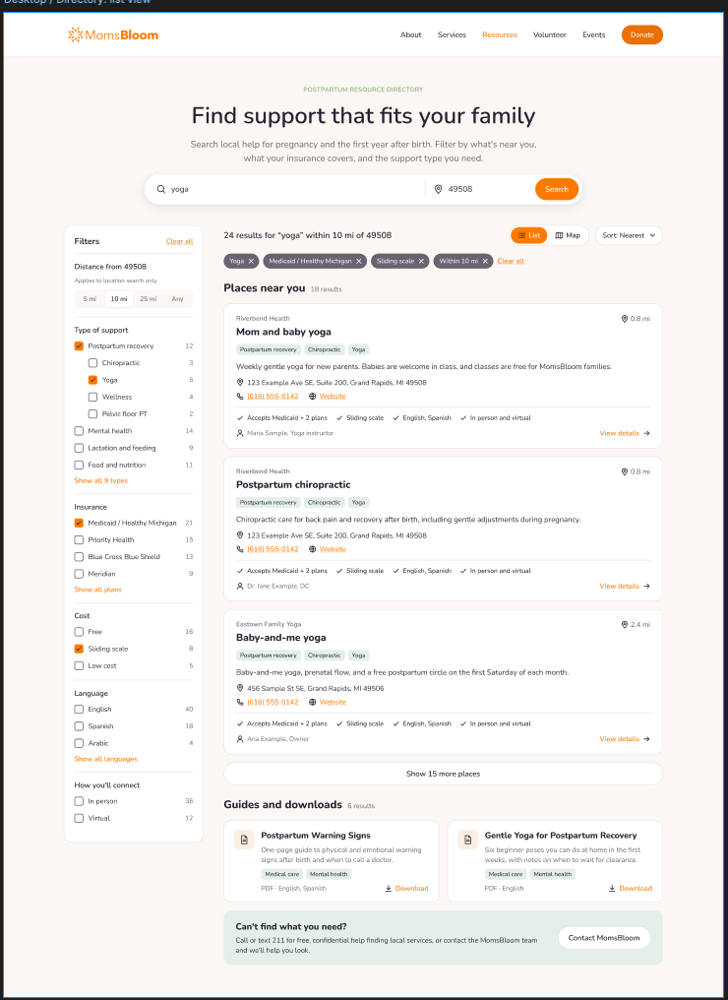

Notes:

- The filter column is on the left: distance, type of support (categories with subcategories
  indented below them), insurance, cost, language, and how you'll connect (in person or virtual).
  Each option shows a count.
- Each active filter shows as a dark chip above the results, with an "x" to remove it, and a
  "Clear all" link.
- "List" and "Map" switch the view. "Sort" offers Nearest (and more; see the handoff doc).
- The green box at the bottom ("Can't find what you need?") always shows at the end of the results.

### Mobile

[Open in Figma](https://www.figma.com/design/XNxEurTwFpvw3kvVLPlea4/WFG-2026---MomsBloom?node-id=5-353)

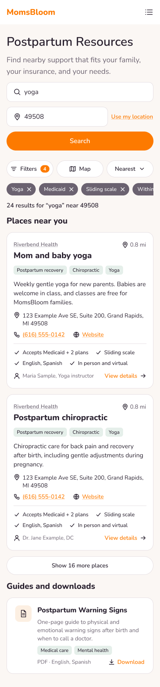

Notes:

- The filters move into a sheet that opens from the "Filters" button (next section). The number on
  the button is how many filters are active.
- "Use my location" is an alternative to typing a ZIP code.

## Mobile filters sheet

[Open in Figma](https://www.figma.com/design/XNxEurTwFpvw3kvVLPlea4/WFG-2026---MomsBloom?node-id=5-585)

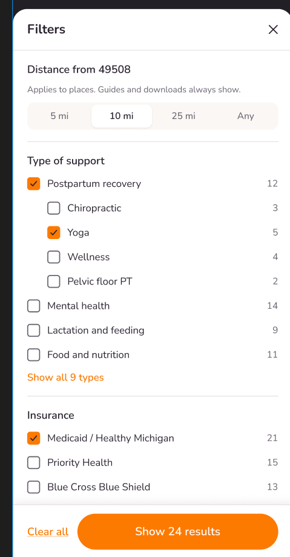

Notes:

- The sheet slides up from the bottom and holds the same filter groups as the desktop column.
- Results update while the sheet is open. The button at the bottom shows the new count
  ("Show 24 results") and closes the sheet.

## Directory: map view (desktop)

[Open in Figma](https://www.figma.com/design/XNxEurTwFpvw3kvVLPlea4/WFG-2026---MomsBloom?node-id=7-541)

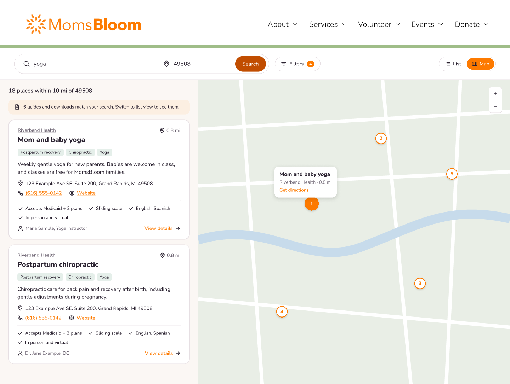

Notes:

- The map is a stretch goal. Build the list view first.
- Programs show as numbered pins. The pin and its card are linked: selecting one highlights the other.
- Documents do not show on the map. The orange note above the cards tells families to switch to the
  list to see them.

## Program detail

The page for one program. It opens when a family selects "View details" on a card.

### Desktop, with map

[Open in Figma](https://www.figma.com/design/XNxEurTwFpvw3kvVLPlea4/WFG-2026---MomsBloom?node-id=20-858)

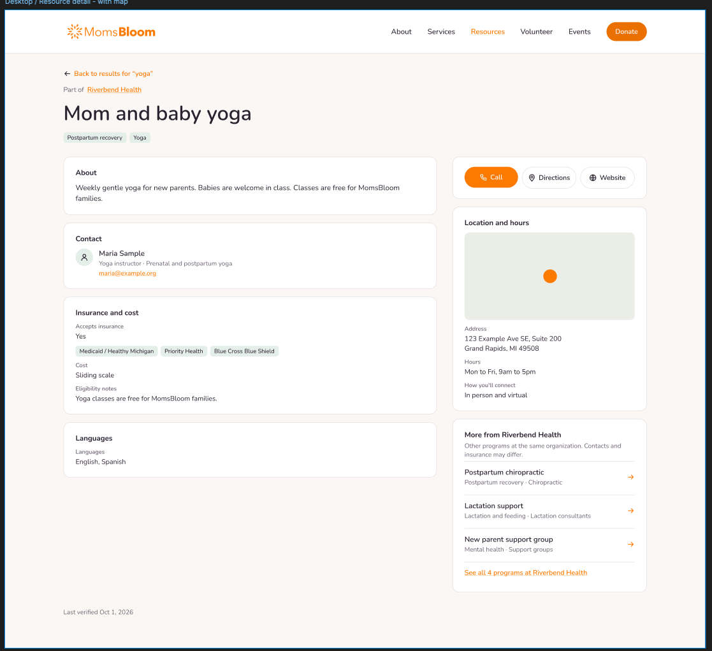

### Desktop, no map

[Open in Figma](https://www.figma.com/design/XNxEurTwFpvw3kvVLPlea4/WFG-2026---MomsBloom?node-id=21-884)

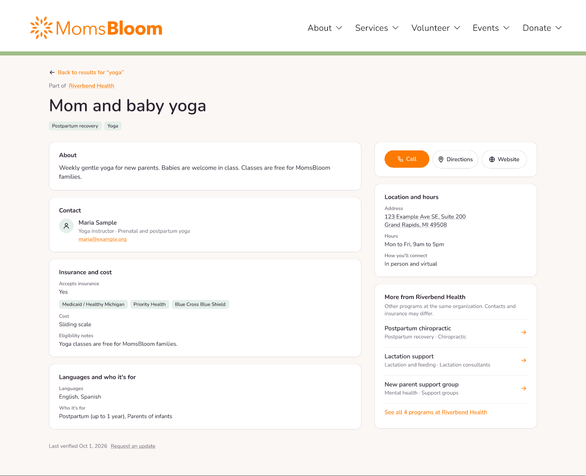

### Mobile, with map

[Open in Figma](https://www.figma.com/design/XNxEurTwFpvw3kvVLPlea4/WFG-2026---MomsBloom?node-id=7-726)

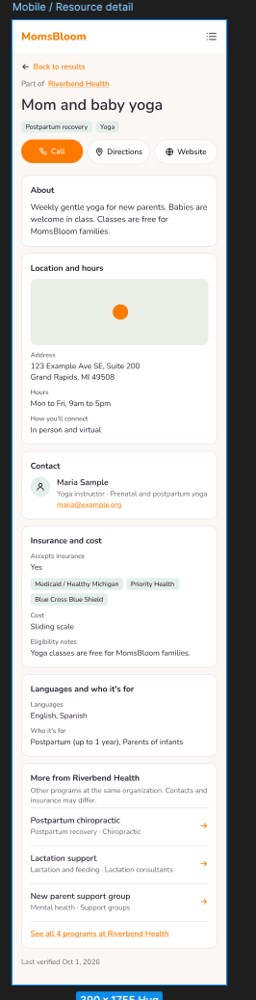

### Mobile, no map

[Open in Figma](https://www.figma.com/design/XNxEurTwFpvw3kvVLPlea4/WFG-2026---MomsBloom?node-id=21-1050)

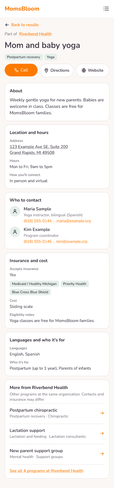

Notes for all four:

- "Part of Riverbend Health" names the organization that runs the program. It links to results
  filtered to that organization.
- Call, Directions, and Website are the main actions. On mobile they sit at the top.
- "More from Riverbend Health" lists the organization's other programs. Hide this section when the
  organization has only one program.
- The "no map" versions are the fallback if we cut the map. The mobile "no map" frame also shows
  two contacts, a "Who to contact" heading, and a phone number per contact.
- "Last verified" comes from the data and tells families how fresh the information is.

## Components

[Open in Figma](https://www.figma.com/design/XNxEurTwFpvw3kvVLPlea4/WFG-2026---MomsBloom?node-id=3-34)

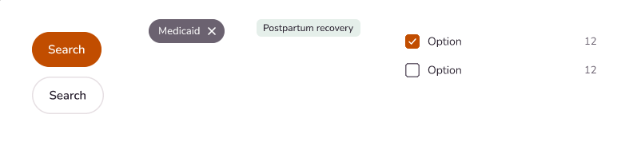

The small pieces that repeat on every screen: the primary button (orange, fully rounded), the
secondary button (white with a border), a filter chip (dark, with an "x"), a tag (light green), and a
checkbox row with a count. Build each one once and reuse it.

The program card and the document card are Figma components too. You can see both in the desktop
list view above.

## Icons

[Open in Figma](https://www.figma.com/design/XNxEurTwFpvw3kvVLPlea4/WFG-2026---MomsBloom?node-id=3-4)

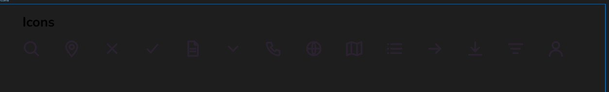

The icons are dark on a transparent background, so they are hard to see in this capture. There are
14, at 16 px with a 1.5 px line: search, map pin, close (x), check, file, chevron down, phone, globe,
map, list, arrow right, download, filter, and user. They look like the free
[Lucide](https://lucide.dev/icons) icon set (the `lucide-react` package). Compare them in Figma
before you add that package.

## Branding

[Open in Figma](https://www.figma.com/design/XNxEurTwFpvw3kvVLPlea4/WFG-2026---MomsBloom?node-id=1-722)

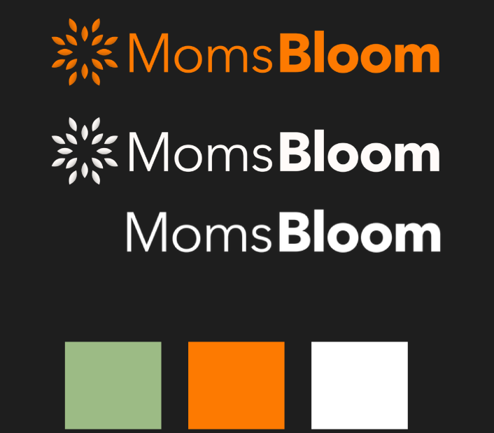

The logo in orange and in white, and the three brand colors: green (#9DBB86), orange (#FD7A00), and
white. The embed does not show the logo, because the Squarespace header already does.

## Designer to-do list

[Open in Figma](https://www.figma.com/design/XNxEurTwFpvw3kvVLPlea4/WFG-2026---MomsBloom?node-id=21-1172)

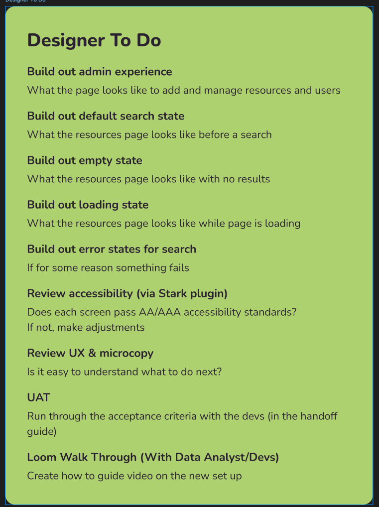

None of the screens on this list existed when the captures were taken. The "Admin Designs" page in Figma was
empty.

## Not captured

The Option B frames (Airtable and Softr) are on the same Figma page. We do not use them, because the
team chose Next.js and Neon instead. The "Cover" and "Design Exploration" pages are also not here.
