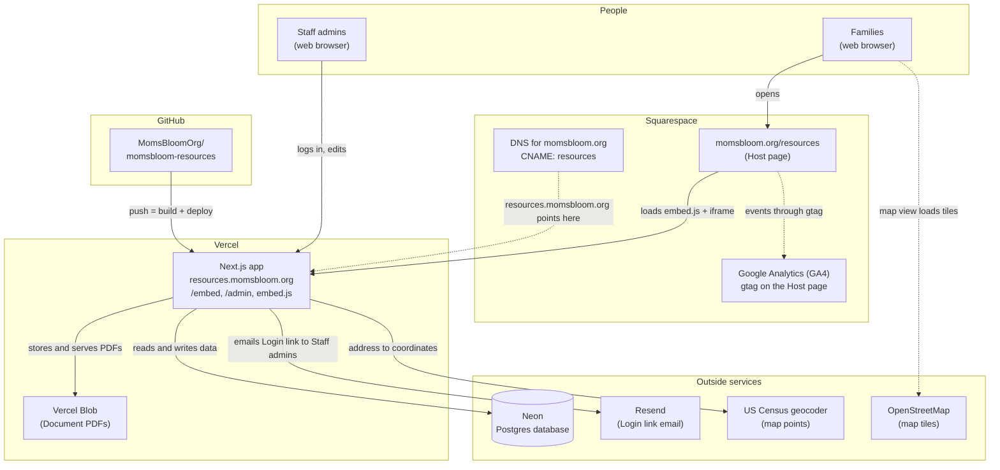

# MomsBloom Resource Directory: Technical Guide

This guide tells how the MomsBloom Resource Directory is set up: the parts, how they connect, the settings, how a change goes live, and what to do when something goes wrong.

## What the app is

The Resource Directory is a searchable list of community services for pregnant and postpartum families in Kent County, Michigan. It has two parts:

- **The Directory.** Families search, filter, and open Programs and Documents. They see it inside the momsbloom.org/resources page (the **Host page**), as an **Embed**. Families never log in.
- **The Admin.** MomsBloom **Staff admins** log in with an email link and keep the data current. The Admin is at `https://resources.momsbloom.org/admin` and no other website can show it.

One Next.js application serves both parts. It runs on Vercel at `resources.momsbloom.org`.

### Words used in this guide

| Word | Meaning |
| --- | --- |
| **Organization** | A group that offers services, for example a hospital or an agency. It has one or more Programs. |
| **Program** | One service that an Organization offers. Families search, filter, and open Programs. |
| **Contact** | A person who works in one Program. Shown to families only when "Show on website" is yes. |
| **Document** | A downloadable guide (a PDF) in "Guides and downloads". |
| **Status** | `Active` (shows), `Needs review` (shows; staff should check it), or `Inactive` (hidden, but kept). |
| **Directory** | The public part of the app: search, filters, results, and the Program detail page. |
| **Host page** | The Squarespace page that holds the Directory: momsbloom.org/resources. |
| **Embed** | The Directory as shown inside the Host page, in an iframe. |
| **Admin** | The part of the app where Staff admins log in and change the data. |
| **Staff admin** | A MomsBloom staff member who can log in to the Admin. Families never log in. |
| **Owner** | A Staff admin set by the developer in the `ADMIN_EMAILS` setting. An Owner can always log in. |
| **Role** | What a Staff admin may do: **Admin** (everything) or **Editor** (Organizations, Programs, Contacts, and Documents only). |
| **Login link** | The email that a Staff admin gets to log in. There is no password. |

## The parts



Solid lines are requests that the app or a person makes. Dotted lines are settings or side paths.

### Vercel: hosting and deploys

- Runs the Next.js app at `resources.momsbloom.org`. Vercel adds the HTTPS certificate.
- Builds and deploys each push to GitHub (see [Deploys](#deploys)). There is no separate deploy script or deploy key to look after, and each pull request gets a preview link that a reviewer can open on a phone.
- Holds the secrets in **Project Settings → Environment Variables** (see [Settings](#settings)).
- **Vercel Blob** stores the Document PDFs. A Staff admin's browser uploads the PDF directly to Blob after the app checks that the person is logged in. Only PDFs of 20 MB or less are accepted.
- The app keeps a cached copy of the Directory data (the "snapshot") on Vercel. Each Admin save clears it, so families see the change on their next page load. With the snapshot, a search does not need a database query, so search stays fast.

### Neon: the database

- A hosted Postgres database. It holds all Organizations, Programs, Contacts, Documents, Facet values, custom fields, Staff admins, login sessions, and the rate-limit counters.
- The app connects with the `DATABASE_URL` setting. A `*.neon.tech` host uses the Neon serverless driver; any other host (a local Docker database) uses the normal Postgres driver.
- Table changes are SQL migration files in the `drizzle/` folder. A developer applies them with `pnpm db:migrate`.
- The database is the source of truth. The spreadsheet was loaded one time (the Seed import) and is not used now.

### Resend: email

- Sends the **Login link** email to Staff admins. This is the only email the app sends.
- The app sends only to addresses on the Staff admin list: the Owners in `ADMIN_EMAILS`, and the Staff admins added on the Admin's Staff admins page.
- The From address is `"MomsBloom Resources" <no-reply@momsbloom.org>`, unless `EMAIL_FROM` changes it. The `momsbloom.org` domain must be verified in Resend, or Resend refuses to send.
- On a developer's computer with no `RESEND_API_KEY`, the link prints in the terminal. On Vercel this is refused, so a Login link never shows in the Vercel logs.
- There are no passwords to store, reset, or steal. A person who can read the email can log in, so the allow-list is the main control.

### Squarespace: the main website and DNS

- **The Host page.** `momsbloom.org/resources` has one Embed block (a Code block also works) with this line:

  ```html
  <script src="https://resources.momsbloom.org/embed.js" async></script>
  ```

  `embed.js` adds an iframe that shows `https://resources.momsbloom.org/embed`. The page in the iframe sends its height to `embed.js`, and `embed.js` sets the iframe to that height, so there is no second scroll bar.
- **Shared links.** `embed.js` copies the family's filters into the Host page address with the prefix `mbr-` (for example `?mbr-q=yoga`). A copied link opens the same results. The prefix keeps these keys apart from Squarespace's own keys.
- **Analytics.** The Directory sends events (search, filter, Program view, call, directions) to `embed.js`, and `embed.js` gives them to the Host page's own Google Analytics (`gtag`). The app itself loads no Google code and sets no cookies. The events go to the same GA4 property as the rest of momsbloom.org.
- **DNS.** Squarespace manages the DNS for `momsbloom.org`. A `CNAME` record for `resources` points to Vercel.

### Smaller parts

| Part | What it does | Account or key |
| --- | --- | --- |
| GitHub (`MomsBloomOrg/momsbloom-resources`) | Holds the code. Vercel watches it. The repo is public. | GitHub organization |
| US Census geocoder | When a Staff admin saves an address, the app gets its map coordinates. Free. Only the Census sees the address. | None |
| OpenStreetMap tiles | The map view in the Directory loads its map images from `tile.openstreetmap.org`. | None |

## Settings

Settings are environment variables. On Vercel, set them in **Project Settings → Environment Variables**, for Production and Preview. On a developer's computer, they go in `.env.local` (copy `.env.example`). Never put a value in the repo: the repo is public.

| Setting | What it is | Needed on Vercel |
| --- | --- | --- |
| `DATABASE_URL` | The Neon connection string. | Yes |
| `AUTH_SECRET` | Signs the login cookies and keys the rate limit. Make one with `openssl rand -base64 32`. | Yes |
| `RESEND_API_KEY` | The Resend API key. | Yes |
| `EMAIL_FROM` | The From address of the Login link. | Yes |
| `ADMIN_EMAILS` | The Owners, separated by commas. Owners can always log in and always have the Admin role. | Yes |
| `BLOB_READ_WRITE_TOKEN` | Lets the app use Vercel Blob. Vercel adds it when a Blob store is connected to the project. | Yes (added by Vercel) |
| `AUTH_URL` | Local and test only. **Do not set on Vercel.** | No |
| `EMBED_EXTRA_FRAME_ANCESTORS` | Extra sites that may show `/embed`. Local tests only. | No (leave empty) |

A change to a setting on Vercel takes effect only after a new deploy (**Deployments → ⋯ → Redeploy**).

## Deploys

1. A developer pushes a branch to GitHub and opens a pull request.
2. Vercel builds the branch and posts a **Preview** link in the pull request. Reviewers check the change there, also on a phone.
3. The pull request is merged into `main`.
4. Vercel builds `main` and deploys it to **Production** (`resources.momsbloom.org`).
5. If a build fails, Vercel does not deploy it. The site that was live stays live.

Before a pull request, developers run `pnpm lint && pnpm typecheck && pnpm test`. The browser tests (`pnpm test:e2e`) test the Embed with a fake Host page.

## Security

- **Only momsbloom.org can show the Directory.** The `frame-ancestors` header lets only `momsbloom.org`, `www.momsbloom.org`, and `*.squarespace.com` (the Squarespace editor) show `/embed` in an iframe. No site can show the Admin in an iframe.
- **Only Staff admins get a Login link.** Other addresses get the same "check your email" answer, but no email, so the page does not tell who is a Staff admin.
- **Rate limits on Login links:** 10 links for each email address and 20 requests for each network address (IP), in each hour.
- **Login links** work one time and expire in 24 hours. A login session lasts 7 days.
- **Internal notes** and private Contacts are never sent to the Directory.
- **`embed.js`** accepts messages only from its own iframe and checks each value. It sends only allowed analytics events. It replaces a search word that has an `@` or 5 or more digits with `(redacted)`, so email addresses and phone numbers do not go to Google Analytics.

## Run book

### Where to look first

| Place | What you see there |
| --- | --- |
| Vercel → Project → **Logs** | Errors and log lines from the app. Search for the text in quotes below, for example `[auth]`. |
| Vercel → Project → **Deployments** | Which deploy is live, failed builds, Redeploy, and Instant Rollback. |
| Vercel → Project → **Settings → Environment Variables** | The settings. |
| Neon dashboard | Whether the database is up, its usage, and its connection string. |
| Resend dashboard → **Emails** and **Domains** | Each email that was sent or refused, and whether `momsbloom.org` is verified. |
| Squarespace → the Resources page, Embed block | The `embed.js` line and the block width. |
| The browser's developer tools → **Console** | Errors on the Host page, for example "refused to connect". |

### The Directory is blank on momsbloom.org/resources, or says "refused to connect"

- **Likely causes**
  - The page is on a domain that is not on the allowed list (for example a new Squarespace domain or a different `*.squarespace.com` preview).
  - The `resources` DNS record is missing or wrong, so `resources.momsbloom.org` does not open.
  - The Embed block does not have the `embed.js` line, or the line has a typo.
- **Check**
  1. Open `https://resources.momsbloom.org/embed` directly. If it does not open, the problem is DNS or Vercel (see [The site is down](#the-site-is-down-or-shows-an-error-page)).
  2. On the Host page, open the browser Console. A `frame-ancestors` error means the domain is not allowed.
  3. In Vercel → **Settings → Domains**, check that `resources.momsbloom.org` shows **Valid**.
- **Fix**
  - A new domain: a developer adds it to `EMBED_FRAME_ANCESTORS` in `src/embed/frame-ancestors.ts` and deploys.
  - DNS: in Squarespace → **Domains → momsbloom.org → DNS settings**, add or fix the `CNAME` record for `resources` with the value that Vercel shows.
  - The Embed block: paste the line from [Squarespace](#squarespace-the-main-website-and-dns) again.

### The Directory has a second scroll bar, is cut off, or is too narrow

- **Likely causes**
  - The block holds a bare `<iframe>` and not the `embed.js` script. A bare iframe cannot change its height.
  - The block is not full width. A new block in the Squarespace editor is only a few columns wide.
  - A recent change to `embed.js` is not in the browser yet. Browsers keep `embed.js` for 5 minutes.
- **Check** the block content and width in the Squarespace editor. Reload the page after 5 minutes.
- **Fix** Use only the `embed.js` line. Drag the block edge across the full width of the section.

### A Staff admin gets no Login link

- **Likely causes**
  - The address is not on the Staff admin list, or has a typo. The page shows the same "check your email" answer for every address, so the person cannot see this.
  - An Owner was added to `ADMIN_EMAILS` but there was no redeploy after the change.
  - The rate limit: more than 10 links for one address, or 20 requests from one network, in one hour.
  - Resend refused the email, or the `momsbloom.org` domain is not verified in Resend.
  - The email is in the spam or junk folder.
- **Check**
  1. In the Admin, open **Staff admins** and find the address. For an Owner, check `ADMIN_EMAILS` in Vercel.
  2. In Vercel Logs, search for `[auth]`:
     - `Refused sign-in: not on the Staff admin list.` — the address is not on the list.
     - `Magic link not sent: rate limit (email)` or `(ip)` — the rate limit stopped it.
     - `Login link email failed` — Resend refused it. The line gives the reason.
     - `Refused link request: not a valid email address.` — a typo in the address.
  3. In Resend → **Emails**, find the email and its status. In Resend → **Domains**, check that `momsbloom.org` is verified.
- **Fix**
  - Add the address on the Staff admins page (an Admin-role Staff admin can do this). For an Owner, change `ADMIN_EMAILS` in Vercel and redeploy.
  - The rate limit: wait one hour.
  - Resend: fix the domain records that Resend shows (they go in Squarespace DNS), or replace an expired API key in `RESEND_API_KEY` and redeploy.
  - Spam: ask the person to mark the email "not spam" and to add `no-reply@momsbloom.org` to their contacts.

### A Login link says it expired, or it does not work

- **Likely causes**
  - The link is more than 24 hours old, or was used already. Each link works one time.
  - An email security scanner (common at hospitals and large employers) opened the link before the person did, so the link was used.
  - The person asked for more than one link and clicked an older one.
- **Fix** Ask for a new link on the login page and use the newest email. If a scanner uses each link, ask the person's IT team to let `resources.momsbloom.org` links through without a scan.

### A change in the Admin does not show in the Directory

- **Likely causes**
  - The family's page was open before the save. The Directory shows the new data on the next page load.
  - The record's **Status** is **Inactive**, or its Organization is Inactive. Inactive records do not show.
  - The save failed. The Admin shows an error next to the field.
- **Check** Reload the Host page. Check the Status of the Program and of its Organization.
- **Fix** Set the Status to **Active** or **Needs review**, and save. If the change still does not show after a reload, save the record one more time. Each save clears the cached snapshot. If that fails, redeploy in Vercel; a new deploy starts with an empty cache.

### A Program has no pin on the map

- **Likely causes**
  - The US Census geocoder found no match for the address. The Admin then shows "We couldn't place this address on the map." The save still works.
  - The Program has no street address of its own and its Organization has no map point.
  - The Program's Service format is Virtual. Virtual-only Programs have no pin.
- **Fix** Check the street, city, state, and ZIP for typos and save again. If the Census still finds no match (new buildings, PO boxes, rural routes), type the latitude and longitude by hand. Get them from a map site: right-click the place and copy the numbers.

### A PDF upload fails

- **Likely causes**
  - The file is larger than 20 MB.
  - The file is not a PDF.
  - The login session expired (7 days). The upload is refused.
  - The Vercel Blob store is not connected to the project, so `BLOB_READ_WRITE_TOKEN` is missing.
- **Fix** Make the PDF smaller (for example "Reduce file size" in Preview or Acrobat), or log in again. If every upload fails, check in Vercel → **Storage** that the Blob store is connected to this project, then redeploy.

### The site is down, or shows an error page

- **Likely causes**
  - Neon is down, suspended, or over its plan limits.
  - `DATABASE_URL` is wrong or the password changed in Neon.
  - The last deploy has a bug.
  - Vercel or Neon has an outage.
- **Check**
  1. Vercel Logs: look for `[db] Neon Pool error` or `DATABASE_URL`.
  2. Neon dashboard: check that the project and its compute are active, and check usage.
  3. [Vercel status](https://www.vercel-status.com) and [Neon status](https://neonstatus.com).
  4. Vercel → **Deployments**: did the problem start with the newest deploy?
- **Fix**
  - A bad deploy: in Vercel → **Deployments**, open the last good deploy and use **Instant Rollback** (see [Vercel docs: Instant Rollback](https://vercel.com/docs/instant-rollback)). Then fix the code in a new pull request.
  - A new database password: copy the connection string from Neon to `DATABASE_URL` in Vercel and redeploy.
  - Neon limits: see [Neon docs: plans](https://neon.com/docs/introduction/plans) and upgrade the plan if needed.
- **Note** If the Help box or the Directory heading cannot load, the Directory shows the default text and logs `content failed to load; showing the defaults.` The rest of the Directory still works.

### Events do not show in Google Analytics

- **Likely causes**
  - The Host page has no Google Analytics (`gtag`). With no `gtag`, `embed.js` drops the events.
  - GA4 shows new events only after up to 24 to 48 hours in its standard reports.
- **Check** In GA4 → **Reports → Realtime**, open the Host page and do a search. Look for `directory_search`.
- **Fix** Connect Google Analytics to the Squarespace site (see "Google Analytics" in [Squarespace help](https://support.squarespace.com)).

### A shared link does not open the same results

- **Likely causes**
  - The link was copied from inside the iframe (right-click on a link) and not from the browser's address bar.
  - An app or email program removed the `mbr-` parts from the address.
- **Fix** Use the Directory's **Share** button, or copy the address from the browser's address bar. The address must keep its `mbr-` parts, for example `https://www.momsbloom.org/resources?mbr-q=yoga`.
